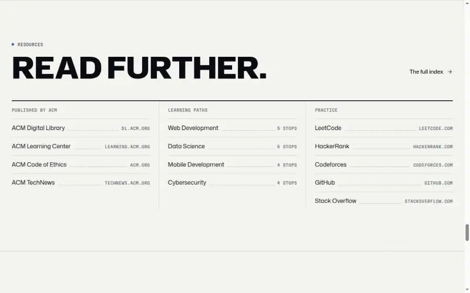
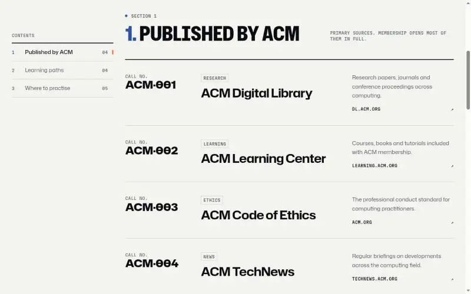
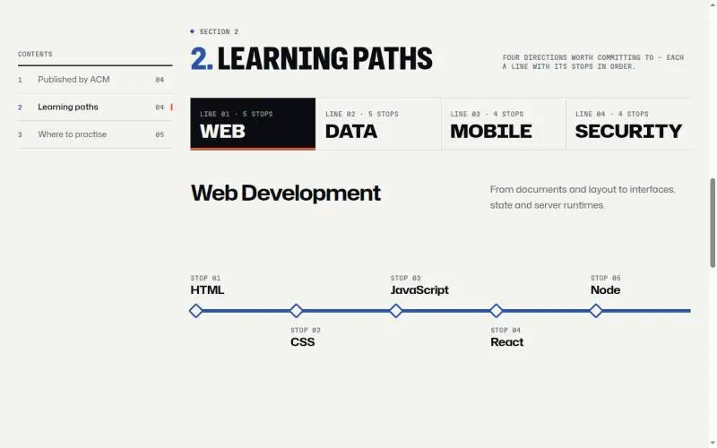
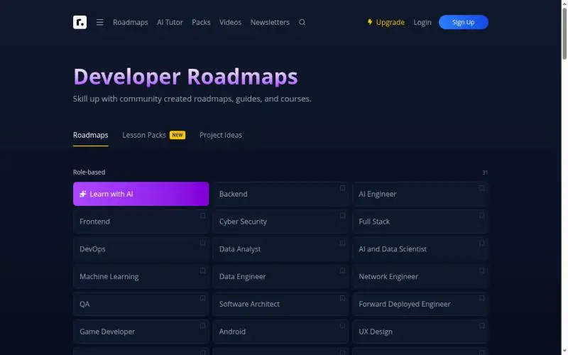
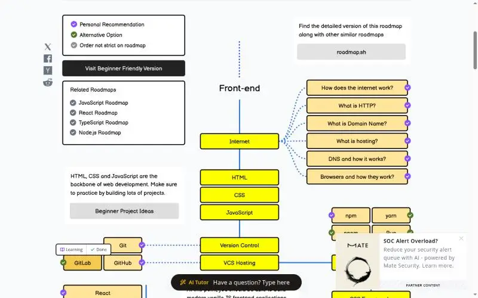
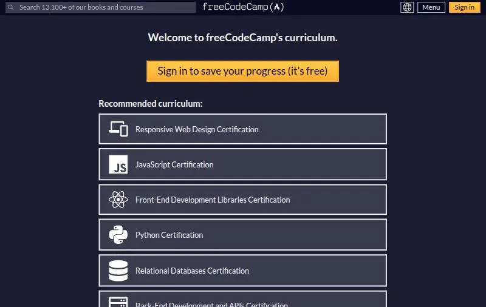
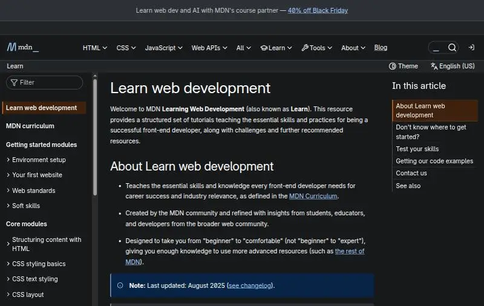
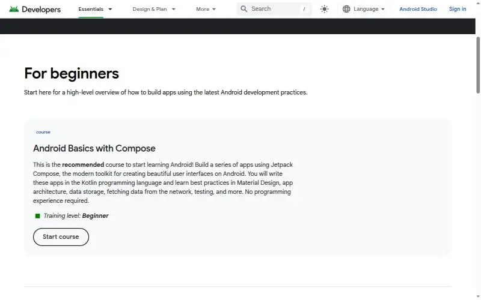
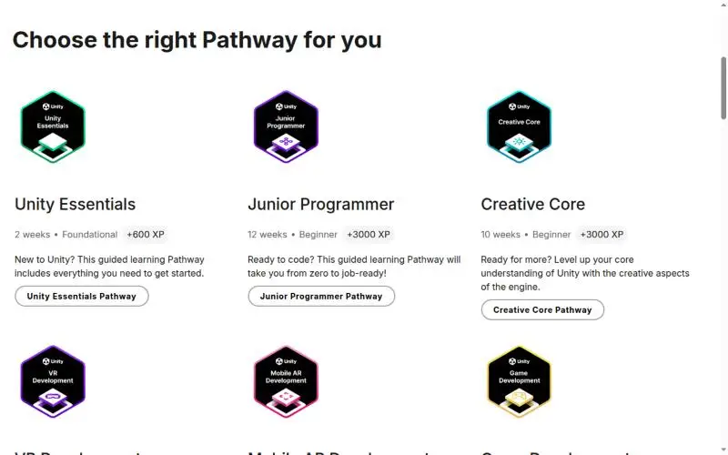

# Research: learning resources content and UI patterns

Ticket: #36. Feeds #45 (resources data and admin editor) and #46 (resources page and home section).
Study date: 2026-11-23. Research only: no code or database change ships with this document.

## Short answer

- **Content:** 53 free (or mostly free) resources across six tracks, each with Arabic and English
  titles, type, level, content language and a link checked on 2026-11-23. Six are in Arabic.
- **Pattern:** every site studied groups by **track first**. Level and type are labels on the card,
  not top-level sections. Only uos.acm.org shows a short resources selection on its home page, and
  it is a plain text index with no images.
- **Recommendation:** a `club_resources` table with real columns (`title`/`title_en`,
  `description`/`description_en`, `url`, `track`, `type`, `level`, `content_language`, `cost`,
  `featured`, `display_order`). The public page is one list grouped by track with chip filters for
  track, level and language. The home section is a three-column text index of featured items, in
  the uos.acm.org style, built from existing `club-card`, `PageHeading` and `Reveal` pieces.
- **Decisions still needed:** listed at the end under [Open questions](#4-open-questions-for-the-supervisor).
  The largest is that `PRODUCT.md` says the collections are exactly four, so adding resources
  changes product scope.

---

## 1. Starter content

How each link was checked: `curl -L` with a browser user agent on 2026-11-23, then the built-in
browser for any link that answered 403/429 or redirected. Every link below loaded and showed the
page it claims to. Links that failed were replaced or dropped (see [Links rejected](#links-rejected)).

Columns: **Type** is one of course, roadmap, docs, video, book. **Level**: B = beginner
(مبتدئ), I = intermediate (متوسط), A = advanced (متقدم). **Lang** is the language of the material
itself. **Cost**: free, or "free tier" when part of it needs payment.

### Web (تصميم وبرمجة صفحات الويب) — key `web`

| Arabic title                      | English title                      | Type    | Level | Lang | Cost | Link                                                           |
| --------------------------------- | ---------------------------------- | ------- | ----- | ---- | ---- | -------------------------------------------------------------- |
| خارطة طريق مطور الواجهات الأمامية | Frontend developer roadmap         | roadmap | B     | en   | free | https://roadmap.sh/frontend                                    |
| خارطة طريق مطور الواجهات الخلفية  | Backend developer roadmap          | roadmap | I     | en   | free | https://roadmap.sh/backend                                     |
| خارطة طريق المطور الشامل          | Full-stack developer roadmap       | roadmap | I     | en   | free | https://roadmap.sh/full-stack                                  |
| تعلّم تطوير الويب من MDN          | MDN: Learn web development         | course  | B     | en   | free | https://developer.mozilla.org/en-US/docs/Learn_web_development |
| منهج freeCodeCamp                 | freeCodeCamp curriculum            | course  | B     | en   | free | https://www.freecodecamp.org/learn                             |
| تعلّم HTML من web.dev             | web.dev: Learn HTML                | course  | B     | en   | free | https://web.dev/learn/html                                     |
| تعلّم CSS من web.dev              | web.dev: Learn CSS                 | course  | B     | en   | free | https://web.dev/learn/css                                      |
| مسارات The Odin Project           | The Odin Project paths             | course  | B     | en   | free | https://www.theodinproject.com/paths                           |
| دليل JavaScript الحديث            | The Modern JavaScript Tutorial     | book    | B     | en   | free | https://javascript.info/                                       |
| تعلّم React (التوثيق الرسمي)      | React: Learn (official docs)       | docs    | I     | en   | free | https://react.dev/learn                                        |
| موسوعة حسوب                       | Hsoub Wiki (Arabic developer docs) | docs    | B     | ar   | free | https://wiki.hsoub.com/                                        |
| قناة Elzero Web School            | Elzero Web School (YouTube)        | video   | B     | ar   | free | https://www.youtube.com/@ElzeroWebSchool                       |

### Mobile apps (تصميم وبرمجة تطبيقات الموبايل) — key `mobile`

| Arabic title                        | English title                        | Type    | Level | Lang | Cost | Link                                                                |
| ----------------------------------- | ------------------------------------ | ------- | ----- | ---- | ---- | ------------------------------------------------------------------- |
| خارطة طريق مطور أندرويد             | Android developer roadmap            | roadmap | B     | en   | free | https://roadmap.sh/android                                          |
| خارطة طريق Flutter                  | Flutter roadmap                      | roadmap | B     | en   | free | https://roadmap.sh/flutter                                          |
| خارطة طريق مطور iOS                 | iOS developer roadmap                | roadmap | B     | en   | free | https://roadmap.sh/ios                                              |
| أساسيات أندرويد مع Compose (Google) | Android Basics with Compose (Google) | course  | B     | en   | free | https://developer.android.com/courses/android-basics-compose/course |
| تعلّم Flutter (التوثيق الرسمي)      | Learn Flutter (official docs)        | docs    | B     | en   | free | https://docs.flutter.dev/learn                                      |
| البدء بلغة Kotlin                   | Get started with Kotlin              | docs    | B     | en   | free | https://kotlinlang.org/docs/getting-started.html                    |
| دروس SwiftUI من Apple               | SwiftUI tutorials (Apple)            | course  | I     | en   | free | https://developer.apple.com/tutorials/swiftui                       |
| نظام التصميم Material 3             | Material Design 3                    | docs    | I     | en   | free | https://m3.material.io/                                             |

### Mobile games (تصميم وبرمجة ألعاب الموبايل) — key `games`

| Arabic title               | English title                   | Type    | Level | Lang | Cost | Link                                                                           |
| -------------------------- | ------------------------------- | ------- | ----- | ---- | ---- | ------------------------------------------------------------------------------ |
| خارطة طريق مطور الألعاب    | Game developer roadmap          | roadmap | B     | en   | free | https://roadmap.sh/game-developer                                              |
| أساسيات Unity              | Unity Essentials pathway        | course  | B     | en   | free | https://learn.unity.com/pathway/unity-essentials                               |
| مسار المبرمج المبتدئ Unity | Unity Junior Programmer pathway | course  | B     | en   | free | https://learn.unity.com/pathway/junior-programmer                              |
| البدء بمحرك Godot          | Godot: Getting started          | docs    | B     | en   | free | https://docs.godotengine.org/en/stable/getting_started/introduction/index.html |
| أنماط برمجة الألعاب        | Game Programming Patterns       | book    | I     | en   | free | https://gameprogrammingpatterns.com/contents.html                              |
| قناة Brackeys              | Brackeys (YouTube)              | video   | B     | en   | free | https://www.youtube.com/@Brackeys                                              |

### Multimedia (تكنولوجيا الوسائط المتعددة) — key `multimedia`

| Arabic title                    | English title                  | Type    | Level | Lang | Cost | Link                                                              |
| ------------------------------- | ------------------------------ | ------- | ----- | ---- | ---- | ----------------------------------------------------------------- |
| خارطة طريق تصميم تجربة المستخدم | UX design roadmap              | roadmap | B     | en   | free | https://roadmap.sh/ux-design                                      |
| مركز مساعدة Figma               | Figma Learn (help centre)      | docs    | B     | en   | free | https://help.figma.com/hc/en-us                                   |
| قوانين تجربة المستخدم           | Laws of UX                     | docs    | I     | en   | free | https://lawsofux.com/                                             |
| دليل Blender الرسمي             | Blender manual                 | docs    | B     | en   | free | https://docs.blender.org/manual/en/latest/                        |
| تعلّم Inkscape                  | Learn Inkscape                 | docs    | B     | en   | free | https://inkscape.org/learn/                                       |
| تدريب DaVinci Resolve           | DaVinci Resolve training       | book    | B     | en   | free | https://www.blackmagicdesign.com/products/davinciresolve/training |
| مقالات التصميم في أكاديمية حسوب | Hsoub Academy: design articles | docs    | B     | ar   | free | https://academy.hsoub.com/design/                                 |

### General CS and AI (علوم الحاسوب والذكاء الاصطناعي) — key `cs-ai` (new)

| Arabic title                          | English title                        | Type    | Level | Lang | Cost | Link                                                        |
| ------------------------------------- | ------------------------------------ | ------- | ----- | ---- | ---- | ----------------------------------------------------------- |
| CS50: مقدمة في علوم الحاسوب (هارفارد) | CS50x: Introduction to CS (Harvard)  | course  | B     | en   | free | https://cs50.harvard.edu/x/                                 |
| CS50: البرمجة بلغة Python             | CS50P: Programming with Python       | course  | B     | en   | free | https://cs50.harvard.edu/python/                            |
| CS50: الذكاء الاصطناعي بلغة Python    | CS50AI: AI with Python               | course  | I     | en   | free | https://cs50.harvard.edu/ai/                                |
| خارطة طريق علوم الحاسوب               | Computer science roadmap             | roadmap | B     | en   | free | https://roadmap.sh/computer-science                         |
| خارطة طريق مهندس الذكاء الاصطناعي     | AI engineer roadmap                  | roadmap | I     | en   | free | https://roadmap.sh/ai-engineer                              |
| خارطة طريق Git وGitHub                | Git and GitHub roadmap               | roadmap | B     | en   | free | https://roadmap.sh/git-github                               |
| كتاب Pro Git                          | Pro Git (book)                       | book    | B     | en   | free | https://git-scm.com/book/en/v2                              |
| الفصل المفقود من تعليم علوم الحاسوب   | The Missing Semester (MIT)           | course  | B     | en   | free | https://missing.csail.mit.edu/                              |
| دورة Google المكثفة في تعلّم الآلة    | Google Machine Learning Crash Course | course  | I     | en   | free | https://developers.google.com/machine-learning/crash-course |
| دورات Kaggle القصيرة                  | Kaggle Learn                         | course  | B     | en   | free | https://www.kaggle.com/learn                                |
| مقالات البرمجة في أكاديمية حسوب       | Hsoub Academy: programming articles  | docs    | B     | ar   | free | https://academy.hsoub.com/programming/                      |
| منصة سطر (أكاديمية طويق)              | Satr (Tuwaiq Academy)                | course  | B     | ar   | free | https://satr.tuwaiq.edu.sa/                                 |
| منصة مهارة-تك                         | Mahara-Tech (ITI)                    | course  | B     | ar   | free | https://maharatech.gov.eg/                                  |

Satr and Mahara-Tech need a free account to watch courses. Both carry tracks across several
majors (web, mobile, AI, security), so they sit here as general platforms.

### Security (الأمن السيبراني) — key `security` (new)

| Arabic title                          | English title                      | Type    | Level | Lang | Cost      | Link                                           |
| ------------------------------------- | ---------------------------------- | ------- | ----- | ---- | --------- | ---------------------------------------------- |
| خارطة طريق الأمن السيبراني            | Cyber security roadmap             | roadmap | B     | en   | free      | https://roadmap.sh/cyber-security              |
| أخطر عشر ثغرات في تطبيقات الويب OWASP | OWASP Top 10                       | docs    | B     | en   | free      | https://owasp.org/projects/top-ten             |
| أوراق OWASP المختصرة                  | OWASP Cheat Sheet Series           | docs    | I     | en   | free      | https://cheatsheetseries.owasp.org/            |
| أكاديمية أمن الويب (PortSwigger)      | Web Security Academy (PortSwigger) | course  | I     | en   | free      | https://portswigger.net/web-security           |
| مسار ما قبل الأمن (TryHackMe)         | TryHackMe: Pre Security path       | course  | B     | en   | free tier | https://tryhackme.com/path/outline/presecurity |
| تحدي Bandit من OverTheWire            | OverTheWire: Bandit                | course  | B     | en   | free      | https://overthewire.org/wargames/bandit/       |
| مسابقة picoCTF                        | picoCTF                            | course  | B     | en   | free      | https://picoctf.org/                           |

OverTheWire, picoCTF and Kaggle are practice grounds more than courses. They are filed as
`course` here because the five agreed types have no better slot; see open question 3.

### Links rejected

| Link tried                                     | Result on 2026-11-23                    | Used instead             |
| ---------------------------------------------- | --------------------------------------- | ------------------------ |
| `developer.mozilla.org/ar/`                    | Redirects to `en-US`: MDN has no Arabic | MDN listed as English    |
| `freecodecamp.org/arabic/`                     | Blank page in the browser               | Dropped                  |
| `freecodecamp.org/learn/full-stack-developer/` | Redirects to a versioned `-v9` URL      | `freecodecamp.org/learn` |
| `git-scm.com/book/ar/v2`                       | 404: no Arabic Pro Git                  | `git-scm.com/book/en/v2` |
| `blender.org/support/tutorials/`               | Cloudflare 403 challenge                | Blender manual           |
| `docs.flutter.dev/get-started`                 | Redirects to the install page           | `docs.flutter.dev/learn` |
| `satr.codes`                                   | Redirects to `satr.tuwaiq.edu.sa`       | The new address          |
| `docs.godotengine.org/ar/4.x/`                 | 404: no Arabic Godot docs               | English docs             |

Lesson for #45: links rot and redirect. The editor should store the final URL, and a periodic
link check (manual or scripted) belongs in the maintenance notes.

---

## 2. Pattern study

Six sites, uos.acm.org first. Screenshots are 800px wide WebP files in
[`research-learning-resources/`](research-learning-resources/). They show the sites as they were on
2026-11-23 and remain the property of their owners. The notes summarise; no text was copied.

### 2.1 uos.acm.org (University of Sharjah ACM chapter) — main reference





- **Size:** 13 entries in 3 sections. The page says it is short on purpose. A club list should be
  curated, not exhaustive.
- **Grouping:** by purpose, not by level: "published by ACM", "learning paths", "where to
  practise". No level labels anywhere.
- **Filters:** none. A sticky contents list on the side jumps to each section and shows a count.
- **Item card (list sections):** a catalogue number, a small type tag (RESEARCH, LEARNING, ETHICS,
  NEWS), a large title, a one-line description, and the bare domain in a mono font with an
  outbound arrow. No images, no favicons.
- **Learning paths:** four tabs (Web, Data, Mobile, Security). Each shows an ordered line of
  "stops" (for web: HTML, CSS, JavaScript, React, Node) drawn as a metro line. Stops are labels, not
  links.
- **Practice section:** a table of platform, "good for" and address.
- **Home selection:** a "Read further" block of three equal columns, one per section, each a list of
  title plus domain with a dotted leader, and a "The full index" link. Four or five lines per
  column. Text only, so it costs almost nothing to load.
- **For us:** the strongest model. It fits a site with no photographs for this content and a slow
  connection. The metro line needs an ordered steps structure, which is a larger build (open
  question 4).

### 2.2 roadmap.sh




- **Grouping:** two flat lists, "role-based" (31: Frontend, Backend, Android, Game Developer, UX
  Design...) and "skill-based" (62: Python, SQL, Git...). Each heading shows a count.
- **Filters:** none on the index; tabs switch between roadmaps, lesson packs and project ideas.
- **Item card:** title only, in a dense three-column grid of outlined tiles with a bookmark icon.
- **Detail:** a large node diagram. Colour and a check mark distinguish "recommended",
  "alternative" and "order not strict". Each roadmap links related roadmaps and a beginner version.
- **Home selection:** none; the home page is the index itself.
- **For us:** link to roadmap.sh rather than rebuild it. Its role-based roadmaps map cleanly onto
  our four majors (frontend/backend, Android/iOS/Flutter, game developer, UX design). Title-only
  tiles are too thin for our audience, which needs a line saying why an item is worth their time.

### 2.3 freeCodeCamp



- **Grouping:** one recommended curriculum in order, then smaller groups (daily challenge,
  languages, interview prep, professional certifications).
- **Filters:** none; a site-wide search box in the header.
- **Item card:** a full-width row with an icon and the certification name. Order implies level.
- **Home selection:** the marketing home page names the curriculum but does not list items.
- **For us:** a single ordered list is the clearest "start here" signal for a first-year student.
  We can get the same effect by sorting each track by level and by `display_order`.

### 2.4 MDN: Learn web development



- **Grouping:** by level, in modules: "Getting started" (complete beginners), "Core" (essentials),
  "Extension" (after core). The intro states who each group is for.
- **Filters:** a text filter over the side navigation.
- **Item card:** none; it is a documentation tree.
- **Home selection:** not applicable.
- **For us:** MDN is the one site that uses level as the top-level grouping, and it writes the
  level as a sentence ("never coded before?") rather than a badge. We can borrow that wording for
  level filter labels.

### 2.5 Android Developers: training courses



- **Grouping:** by audience: "For beginners", "For experienced Android developers",
  "Certification".
- **Filters:** none on this page.
- **Item card:** a small type word above the title (course, pathway), the title, a two- to
  four-line description, a "Training level" line with a coloured square, and one action button.
- **Home selection:** none on this page.
- **For us:** the closest match to the card we need: type, title, why, level, action. No image.

### 2.6 Unity Learn: pathways



- **Grouping:** a flat grid of six pathways.
- **Filters:** none on this page; the wider catalogue has topic and level filters behind sign-in.
- **Item card:** a badge illustration, title, a meta line (duration, level, XP), a one-line pitch
  and a button.
- **Home selection:** none on this page.
- **For us:** the meta line (time and level together) is useful. The badge art and XP are
  gamification we cannot back with our own content.

### What the six have in common

| Site             | Top-level grouping     | Filters            | Level shown as        | Images on items | Home selection  |
| ---------------- | ---------------------- | ------------------ | --------------------- | --------------- | --------------- |
| uos.acm.org      | Purpose (3 sections)   | None, contents nav | Not shown             | No              | Yes, text index |
| roadmap.sh       | Role / skill           | None               | Not shown             | No              | No              |
| freeCodeCamp     | One ordered curriculum | Search             | Order                 | Icon            | No              |
| MDN              | Level (modules)        | Text filter        | Section heading       | No              | No              |
| Android training | Audience               | None               | "Training level" line | No              | No              |
| Unity Learn      | Flat grid              | None (public)      | Meta line             | Badge art       | No              |

Takeaways:

1. None of the six needs heavy filtering at this size. Filters matter only when a list grows past
   what one screen can scan. At about 50 items, chips for track and level are enough; full-text search is
   not needed yet.
2. Items rarely have images. A resource card is text: type, title, a line on why, level, domain.
3. The home selection, where it exists (uos.acm.org), is a compact text index, not a carousel.
4. Curated and short beats exhaustive for a club.

---

## 3. Recommendation

### 3.1 Data shape

A new table `public.club_resources` with real columns, matching #45 ("real columns, not a jsonb
blob") and the column naming PR #78 uses for events (`title`, `title_en`, `display_order`,
`created_at`, `updated_by`, snake_case, Arabic/English pairs as `x` / `x_en`).

| Column                                   | Type                                                        | Notes                                                                            |
| ---------------------------------------- | ----------------------------------------------------------- | -------------------------------------------------------------------------------- |
| `id`                                     | `uuid` primary key                                          |                                                                                  |
| `title`                                  | `text` 2–200                                                | Arabic title                                                                     |
| `title_en`                               | `text` 2–200                                                | English title                                                                    |
| `description`                            | `text` 0–300                                                | Arabic: one or two lines on why it is worth the time. Plain text, not rich text. |
| `description_en`                         | `text` 0–300                                                | English                                                                          |
| `url`                                    | `text`, `https://` only                                     | Validated with the existing `safeUrl()` on read, as other links are              |
| `track`                                  | `text` in `web, mobile, games, multimedia, cs-ai, security` | Extends the existing `categories` keys in `model.ts`                             |
| `type`                                   | `text` in `course, roadmap, docs, video, book`              |                                                                                  |
| `level`                                  | `text` in `beginner, intermediate, advanced`                |                                                                                  |
| `content_language`                       | `text` in `ar, en`                                          | Language of the material, not of the site                                        |
| `cost`                                   | `text` in `free, free_tier`                                 | Never list paid-only items (open question 6)                                     |
| `featured`                               | `boolean` default false                                     | Picks for the home section, as `topNews` uses `featured`                         |
| `display_order`                          | `integer` 1–9999, nullable                                  | Order inside a track; falls back to level, then title                            |
| `status`                                 | `text` in `draft, published`                                | Same as `publicationStatus` elsewhere                                            |
| `created_at`, `updated_at`, `updated_by` | as on other tables                                          |                                                                                  |

Why these and not more:

- **`content_language`** is the most useful filter for this audience. Most good material is in
  English; a first-year student often wants Arabic first. It is also a fact an editor can check.
- **`description` is short plain text.** The card needs one line, not an article. No rich text
  editor, no images, nothing to compress.
- **No image, favicon or thumbnail.** Fetching third-party favicons would add requests to other
  hosts and data cost on a slow phone, against `PRODUCT.md`'s privacy and "cheap on the wire"
  principles. The domain in text does the same job.
- **No slug or detail page.** Every resource links out; a detail page would only repeat the card.
- **No tags array.** Track, type, level and language cover every grouping the six sites use.

In TypeScript the row maps to the existing `Content` style: `title`/`title_en` and
`description`/`description_en` keep `local(item, "title", lang)` working unchanged. Labels follow
the existing `categories` pattern:

```ts
export const resourceTracks = [
  ...categories, // mobile, web, games, multimedia (existing)
  ["cs-ai", "علوم الحاسوب والذكاء الاصطناعي", "CS and AI"],
  ["security", "الأمن السيبراني", "Security"],
] as const;

export const resourceTypes = [
  ["course", "دورة", "Course"],
  ["roadmap", "خارطة طريق", "Roadmap"],
  ["docs", "توثيق", "Docs"],
  ["video", "فيديو", "Video"],
  ["book", "كتاب", "Book"],
] as const;

export const resourceLevels = [
  ["beginner", "مبتدئ", "Beginner"],
  ["intermediate", "متوسط", "Intermediate"],
  ["advanced", "متقدم", "Advanced"],
] as const;
```

### 3.2 Grouping and filters

- **Group by track**, in the order of the four majors, then CS/AI, then security. Every studied
  site groups by subject first. A student arrives knowing their major, not their level.
- **Inside a track**, sort roadmaps first (they answer "where do I start?"), then by `display_order`,
  then by level.
- **Filters:** one row of chips above the list.
  - Track: "All" plus six chips. Selecting one scrolls to or isolates that group.
  - Level: All / Beginner / Intermediate / Advanced. MDN-style wording works for the tooltip or
    helper text ("never coded before?").
  - Language: All / Arabic / English.
- Keep filter state in the URL query (`?track=web&level=beginner`) so a filtered view can be shared
  on Instagram or WhatsApp, which is how the club's visitors arrive.
- **No search box** until the list passes about 100 items.
- Empty case: if a filter combination matches nothing, say so in one line and offer "clear
  filters". If there are no resources at all, the page and the home section stay hidden and out of
  navigation, the way `isUnavailableSection` handles empty collections (#46 already asks for this).

### 3.3 Page layout (`/resources`, `/en/resources`)

```text
+----------------------------------------------------------+
| PageHeading: مصادر التعلّم / Learning resources          |
| one line: what this list is and that it is curated       |
+----------------------------------------------------------+
| [All] [Web] [Mobile] [Games] [Multimedia] [CS&AI] [Sec]  |  <- chips, wrap on phone
| [All levels] [Beginner] [Intermediate]   [All] [ع] [EN]  |
+----------------------------------------------------------+
| Web · 12                                                 |  <- track heading + count
| +--------------------+ +--------------------+ +--------+ |
| | ROADMAP · Beginner | | COURSE · Beginner  | | ...    | |
| | Frontend roadmap   | | MDN: Learn web dev | |        | |
| | why, one line      | | why, one line      | |        | |
| | roadmap.sh  ↗  EN  | | developer.mozilla… | |        | |
| +--------------------+ +--------------------+ +--------+ |
| Mobile apps · 8                                          |
| ...                                                      |
+----------------------------------------------------------+
```

- One column on phones, two from `md`, three from `lg`.
- **Card** (`club-card`, rounded, `border-border`, `bg-card`, as on the news and events cards, but
  with no media area): a small type tag and level on one line, the title, the one-line description,
  then a footer with the domain in the mono face, an outbound arrow, and a small "ع" or "EN" badge
  for the material's language.
- The whole card is one link (`target="_blank" rel="noopener"`). The arrow uses the same
  language-aware swap as `HomeNews` (`ArrowLeft` in Arabic, `ArrowRight` in English).
- In Arabic pages, wrap domains and English titles in `<bdi>` or `dir="ltr"` so punctuation does not
  jump to the wrong side.
- Track headings reuse the site's section heading style; `Reveal` for the entrance, which already
  honours `prefers-reduced-motion`.

### 3.4 Home section

Do **not** reuse `HomeStories`: it is built around 16:9 photographs, and resources have none.
Follow the uos.acm.org "Read further" index instead.

```text
+----------------------------------------------------------+
| ابدأ التعلّم / Start learning            كل المصادر ←    |
+----------------------------------------------------------+
| WEB              | MOBILE APPS        | GAMES            |
| Frontend ..... roadmap.sh | Android ... roadmap.sh | ... |
| MDN Learn .... mozilla.org| Basics with Compose ...| ... |
| Elzero ....... youtube    | Flutter docs ......... | ... |
+----------------------------------------------------------+
```

- Three columns on desktop, stacked on phones. Two to four featured items per column; a column with
  no featured items is left out.
- Columns are the tracks that have featured items, in track order, at most three on the home page
  (the four majors first).
- Each line: title, dotted leader, domain. One link per line. No descriptions here; the page has
  them.
- Hidden when no resource is featured; the "all resources" link is hidden with it.
- Where on the home page: after events and news, before partners. Events and news show the club is
  active; resources are a reason to come back.

---

## 4. Open questions for the supervisor

1. **Scope.** `PRODUCT.md` says the collections are exactly four (members, events, news,
   partners). Adding resources makes five. Do you agree, and should `PRODUCT.md` and the SRS be
   updated in #45?
2. **Tracks.** Keep the four majors and add `cs-ai` and `security` as above? Or keep only the four
   majors and fold the rest into them?
3. **A `practice` type.** uos.acm.org gives practice platforms (LeetCode, OverTheWire, picoCTF,
   Kaggle) their own section. Add `practice` to the five types, or keep them as `course`?
4. **Ordered learning paths.** uos.acm.org's "metro line" of stops per track needs an ordered steps
   structure (a second table or an ordered list per track). Build it later, or never, and link to
   roadmap.sh for order instead? This document assumes "later", so #45 stays small.
5. **Who maintains the list.** Any editor, or only certain committees? Should a resource carry the
   name of the member who recommended it? (That would be the only people data on a resource.)
6. **Paid material.** Allow "free tier" items such as TryHackMe, or free only? Never paid-only?
7. **Arabic material.** Only six of 53 items are in Arabic. Should the club ask members for Arabic
   recommendations before launch, and should Arabic items sort first on the Arabic page?
8. **Home section.** Agree with a text index of featured items, placed after news and events?
9. **Link health.** Who checks links each semester? A small scripted check could run in CI later;
   it is out of scope for #45 and #46.

## Sources

Studied sites (screenshots in `research-learning-resources/`):

- https://uos.acm.org/ and https://uos.acm.org/resources
- https://roadmap.sh/ and https://roadmap.sh/frontend
- https://www.freecodecamp.org/learn
- https://developer.mozilla.org/en-US/docs/Learn_web_development
- https://developer.android.com/courses
- https://learn.unity.com/pathways

Repository context: `PRODUCT.md`, `src/lib/club/model.ts`, `src/components/club/HomeNews.tsx`,
`docs/uos-acm-study-2026-11-05.md`, issues #45 and #46, PR #78.
